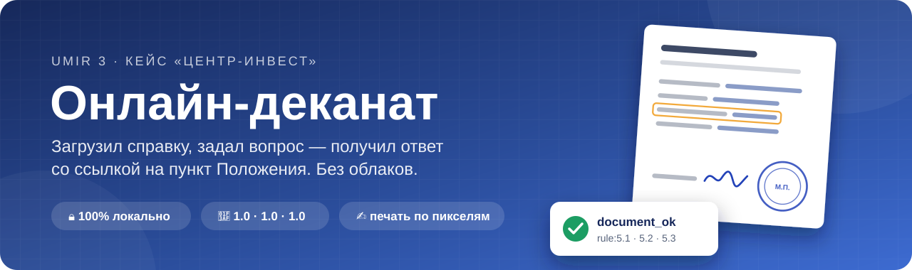
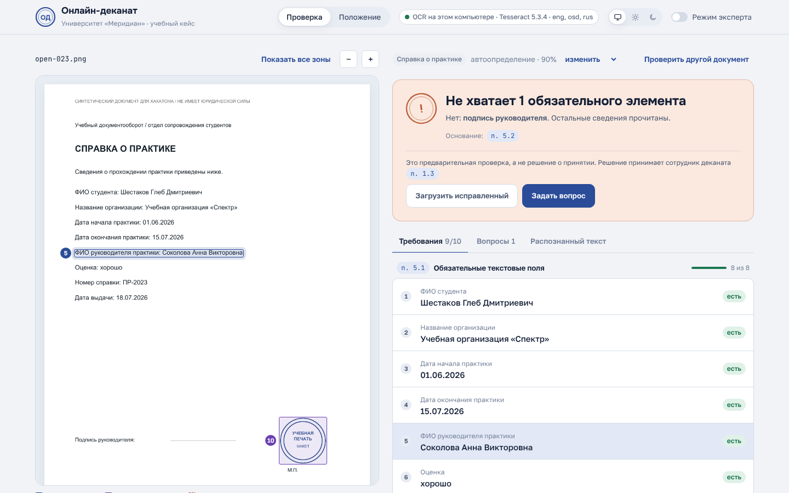
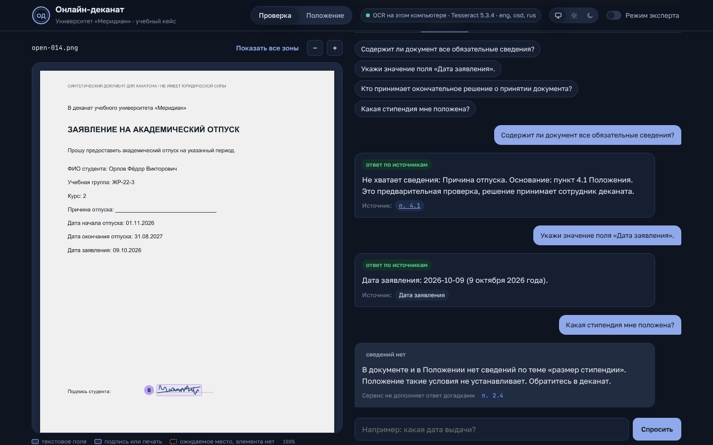
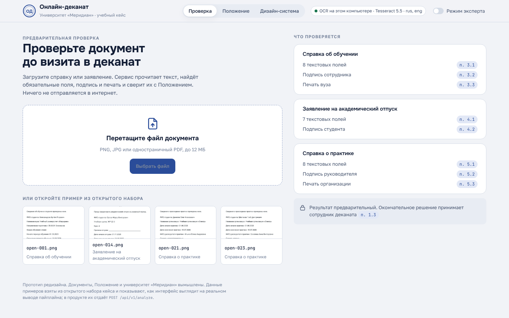
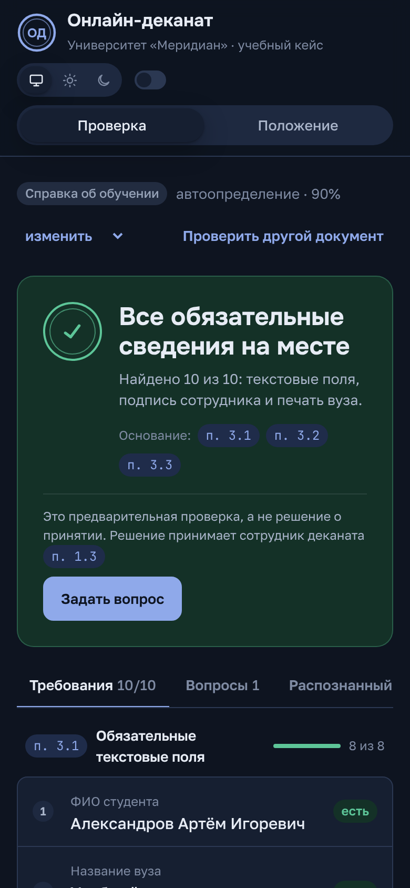
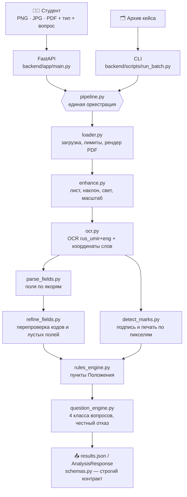
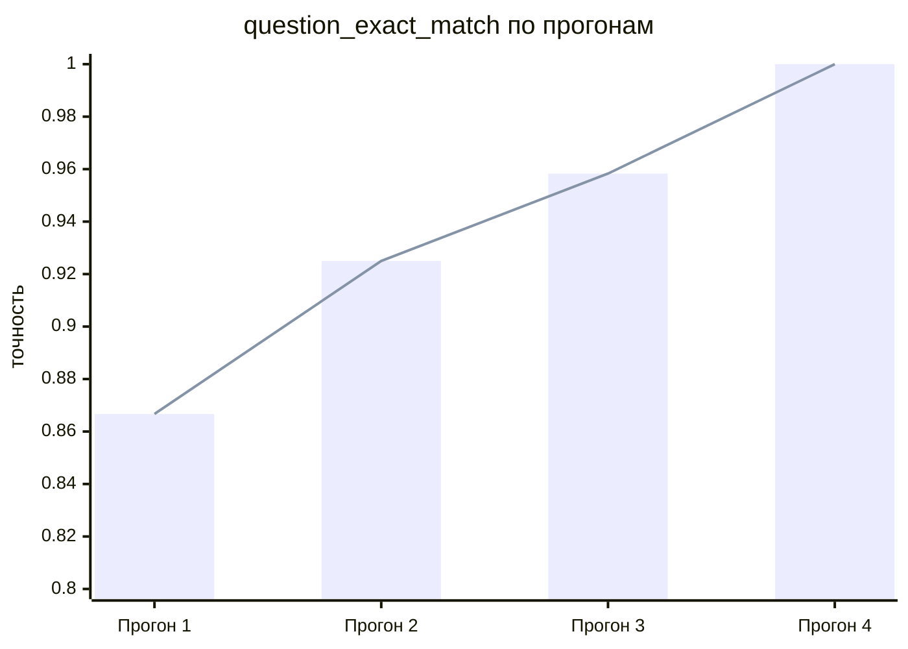

<div align="center">



<br>

**Команда «Баги по колено»** · кейс UMIR 3 «Онлайн-деканат»

<br>


<br>

[🚀 Запуск](#-1-быстрый-старт) ·
[👀 Как выглядит](#-как-это-выглядит) ·
[📊 Цифры](#-цифры-на-одной-странице) ·
[🧱 Архитектура](#-3-архитектура) ·
[🔏 Подпись и печать](#-5-как-работает-обнаружение-подписи-и-печати) ·
[🎬 Демо](#-9-демонстрационный-сценарий--3-минут) ·
[📓 Как мы к этому шли](#-как-мы-к-этому-шли)

</div>

---

## 👋 Что это такое

Студент фотографирует справку, выбирает тип документа (или доверяет нам
угадать его сам) и спрашивает по-русски: *«Всё ли в порядке?»*, *«Когда
начинается практика?»*, *«Кто принимает решение?»*. Сервис распознаёт текст,
собирает карточку полей, проверяет комплектность по Положению
университета «Меридиан» и отвечает **со ссылками** на поля документа и пункты
Положения.

<table>
<tr>
<td width="33%" align="center">

### 📄 → 🔍
**Распознаём**

Своя OCR-модель на вашем компьютере, слова с координатами, PDF и фото с телефона

</td>
<td width="33%" align="center">

### 🔍 → ⚖️
**Проверяем**

все поля, графические подпись и печать, пункты 3.x / 4.x / 5.x Положения

</td>
<td width="33%" align="center">

### ⚖️ → 💬
**Отвечаем**

четыре класса вопросов и честное «в документе и Положении этого нет»

</td>
</tr>
</table>

> [!IMPORTANT]
> * Вся обработка — **локальная**: OCR, извлечение полей и формирование ответов
>   выполняет код этого репозитория. Внешние OCR-, LLM- и облачные API не
>   используются ни в одном режиме.
> * Сервис **никогда не утверждает**, что документ принят: он даёт только
>   предварительную проверку, окончательное решение принимает сотрудник деканата
>   (пункт 1.3 `rules.md`).
> * Источник правил — **только** `rules.md` из пакета кейса. Другие нормы не
>   придумываются и не подменяются правилами реальных вузов.

### ⚡ Попробовать за минуту

```bash
docker build -t umir-dean .
docker run --rm -p 8000:8000 umir-dean        # открыть http://localhost:8000
```

Ещё проще: на Windows дважды кликнуть `start.cmd`, на Linux/macOS запустить
`bash start.sh`. Скрипт сам соберёт образ, поднимет сервис и откроет браузер
(подробности в [1.6](#16-docker-и-google-colab-запуск-без-ручной-установки)).

Без Docker, с подробностями про OCR и пакетный прогон, — в разделе
[🚀 Быстрый старт](#-1-быстрый-старт).

---

## 👀 Как это выглядит

<div align="center">

<br>
<sub>Справка о практике без подписи руководителя. Слева лист с пронумерованными зонами, справа вердикт с пунктом 5.2 и требования по пунктам Положения: клик по строке подсвечивает место на листе.</sub>
</div>

<br>

Интерфейс сделан в концепции «рабочий стол проверяющего». Есть светлая и тёмная
тема: по умолчанию как в системе, переключатель в шапке, выбор запоминается.
Шрифты (Onest, Golos Text, JetBrains Mono) лежат в сборке, поэтому демо работает
без интернета. Ключи полей, уверенность, координаты и `results.json` спрятаны в
«Режим эксперта»; пункты Положения открываются во всплывающей подсказке и в
разделе «Положение».

<p align="center">

</p>

<table>
<tr>
<td width="62%"></td>
<td width="38%"></td>
</tr>
<tr>
<td align="center"><sub>Стартовый экран: что проверяется для каждого типа</sub></td>
<td align="center"><sub>Телефон, тёмная тема</sub></td>
</tr>
</table>

---

## 📊 Цифры на одной странице

Все числа ниже получены командами из этого README; подробности и разбор ошибок —
в [разделе 6](#-6-качество-фактические-метрики-открытого-набора).

| Что проверяли | Поля | Проверка комплектности | Ответы на вопросы |
|---|:---:|:---:|:---:|
| 🟢 Открытый набор организаторов, 30 документов / 120 вопросов (`evaluate.py`) | **1.0** | **1.0** | **1.0** |
| 🧪 Синтетический стресс-набор, 690 новых документов с другими значениями и пропусками (`make_synthetic.py`) | **0.999** | **1.0** | **1.0** |
| 📱 «Плохие снимки»: всё сразу — тень, блик, поворот, перспектива, уменьшение, JPEG | **0.88** | 0.6 | 0.85 |

Точность полей на испорченных страницах по отдельным эффектам
(`make_degraded.py --effect …`, `enhance` включён, как в продукте):

| 🔄 Поворот | 🌗 Тени | 🔎 Низкое разрешение | 🌀 Всё сразу |
|:---:|:---:|:---:|:---:|
| **1.0** | **1.0** | **0.92** | **0.88** |

Ещё немного фактов: автоопределение типа **30/30**, подпись и печать **50/50**
отметок без единого ложного срабатывания, PNG и PDF одного документа дают
**одинаковый** результат на 30/30, **0** обращений к внешним API в коде.

---


## 🚀 1. Быстрый старт

### 1.1. Проверенная среда

| Компонент | Версия, на которой выполнены измерения |
|---|---|
| Python | 3.13.5 (работает и на 3.11+) |
| OCR-движок | 5.5.3, модели `rus_umir`, `rus`, `eng`, `osd` |
| Node.js (только для UI) | 18+ (сборка проверена на Node 24) |
| ОС | Windows 11 (команды ниже кросс-платформенные) |

### 1.2. Установка OCR (обязательно)

OCR-движок — единственный внешний бинарник; веса и зависимости скачиваются
заранее, во время установки. После установки сеть не нужна.

* **Windows**: `winget install --id UB-Mannheim.TesseractOCR` либо установщик с
  <https://github.com/UB-Mannheim/tesseract/wiki>. При установке отметьте
  дополнительный язык **Russian**. Если бинарник не в `PATH`, задайте
  `TESSERACT_CMD` с полным путём к `tesseract.exe`.
* **Debian/Ubuntu**: `sudo apt-get install -y tesseract-ocr tesseract-ocr-rus`
* **macOS**: `brew install tesseract tesseract-lang`
* **Colab**: `!apt-get install -y tesseract-ocr tesseract-ocr-rus`

Проверка: `tesseract --list-langs` должен показать `rus` и `eng`.
Если `rus.traineddata` не найден, укажите каталог через `TESSDATA_PREFIX`.

### 1.3. Установка зависимостей

```bash
python -m venv .venv
# Windows: .venv\Scripts\activate
# Linux/macOS: source .venv/bin/activate
python -m pip install -r requirements.txt
```

Или одной командой через встроенный раннер задач:

```bash
python -m backend.scripts.tasks install
```

### 1.4. Первый прогон: `results.json` и метрики

```bash
python -m backend.scripts.tasks batch      # -> results.json  (30 документов, 120 вопросов)
python -m backend.scripts.tasks evaluate    # -> reports/open-set.json + метрики в консоль
```

Явные команды (эквивалент, как в техническом задании):

```bash
python -m backend.scripts.run_batch \
  --documents "/path/to/archive/documents.json" \
  --questions "/path/to/archive/questions.json" \
  --root      "/path/to/archive" \
  --output    results.json

python "/path/to/archive/evaluate.py" \
  --reference "/path/to/archive/reference_results.json" \
  --predictions results.json
```

Архив кейса ищется автоматически рядом с репозиторием; путь можно задать
переменной `UMIR_ARCHIVE` или флагом `--root` / `--documents` / `--questions`.

### 1.5. Веб-интерфейс

```bash
# 1) backend (FastAPI + локальный OCR)
python -m backend.scripts.tasks api          # http://127.0.0.1:8000

# 2) frontend (Vite, проксирует /api на backend)
cd frontend
npm install        # или: pnpm install
npm run dev        # http://127.0.0.1:5173

# продакшн-сборка: npm run build  -> frontend/dist
# после сборки FastAPI сам раздаёт UI на http://127.0.0.1:8000/
```

Быстрая проверка API без UI:

```bash
curl -F "file=@open-001.png" -F "document_type=study_certificate" \
     -F "question=Содержит ли документ все обязательные сведения?" \
     http://127.0.0.1:8000/api/v1/analyze
```

Адреса, которые отдаёт сервис:

| Метод и путь | Что возвращает |
|---|---|
| `GET /api/v1/health` | состояние сервиса и локального OCR (движок, языки, версия) |
| `GET /api/v1/document-types` | типы документов с ключами полей кейса и пунктами Положения |
| `POST /api/v1/analyze` | `ocr_text`, `fields`, `validation`, `answer`, `boxes` — ключи как в `results.json` |
| `GET /api/doc-types` | те же типы, но в виде, который ждёт фронтенд из ветки `main` |
| `POST /api/analyze` | разбор документа в контракте команды (`full_name`, `study_period`, `seal`) |
| `GET /api/files/{id}/page-1` | страница, по которой работал OCR, — превью для подсветки |
| `GET /api/history` | последние разборы (в памяти процесса, на диск не пишутся) |
| `GET /api/regulation` | полный текст `rules.md` по разделам и пунктам |

Что есть на стартовом экране проверки, кроме выбора файла:

* **примеры**: кнопки «Пример 1–4» загружают готовые документы — полную
  справку об обучении, заявление без подписи и даты, справку о практике в PDF и «фото под
  углом» с тенью. Образцы лежат в `frontend/public/demo/`, их рисует
  `python -m backend.scripts.tasks demo-samples` (документы открытого набора туда не
  копируются);
* **Ctrl+V**: скриншот или скопированную картинку можно просто вставить;
* **камера**: на телефоне есть кнопка «Сфотографировать документ»;
* **секундомер** на экране обработки и итоговое время;
* **«После выравнивания / Исходник»** над страницей, если снимок поворачивали или
  выравнивали свет: видно, что сделала предобработка (рамки полей — на выровненной
  странице).

---

### 1.6. Docker и Google Colab: запуск без ручной установки

**Docker** — OCR, API и собранный интерфейс в одном образе:

```bash
docker build -t umir-dean .
docker run --rm -p 8000:8000 umir-dean        # интерфейс и API: http://localhost:8000
```

Пакетный прогон по архиву кейса (архив монтируется в `/data`, `results.json`
появится рядом с ним):

```bash
docker run --rm -v "/путь/к/архиву:/data" umir-dean \
  python -m backend.scripts.run_batch --documents /data/documents.json \
    --questions /data/questions.json --root /data --output /data/results.json
```

Проверено: образ собирается, прогон открытого набора внутри контейнера даёт
1.0 / 1.0 / 1.0 по `evaluate.py`, `/api/v1/health` и интерфейс отвечают.

**Одной командой (start.cmd / start.sh + docker-compose.yml).** Нужен только
Docker Desktop (Windows/macOS) или Docker Engine с Compose v2 (Linux):

```bash
start.cmd              # Windows: двойной клик или из консоли
bash start.sh          # Linux/macOS (или ./start.sh)
# дальше там же: stop | logs | status | rebuild
```

Скрипт проверит, что Docker запущен, выполнит `docker compose up -d --build`,
дождётся `/api/v1/health` и откроет `http://localhost:8000`. В отличие от
голого `docker run --rm`, пользователи, история и ключ подписи входа лежат в
томе `umir-data` и переживают `stop` и пересборку. Настройки (порт, демо-аккаунт,
ключи Яндекса, название команды) — в файле `.env`, образец в `.env.example`;
`.env` не попадает ни в git, ни в образ.

**Google Colab** — `notebooks/colab_quickstart.ipynb`: ставит OCR,
клонирует репозиторий, принимает zip-архив кейса, пишет `results.json`, считает
метрики и показывает разбор одного документа. Всё выполняется на CPU Colab,
без внешних API.

### 1.7. Развёртывание на своём сервере

Скрипт `scripts/deploy_remote.sh` поднимает сервис на удалённой машине через
Docker и остаётся там для управления:

```bash
bash scripts/deploy_remote.sh                    # развернуть или обновить
bash scripts/deploy_remote.sh status             # состояние, health, потребление памяти
bash scripts/deploy_remote.sh logs               # хвост лога
bash scripts/deploy_remote.sh restart|stop|start
bash scripts/deploy_remote.sh deploy --no-build  # перезапуск на текущем образе
```

Настройки задаются переменными: `APP_DIR` (по умолчанию `/opt/umir-online-dean`),
`PORT` (8000), `MEMORY` (700m), `CPUS` (0.9), `BRANCH` (main).
Ещё две: `DATA_DIR` (`/opt/umir-online-dean-data`, сюда монтируется `/app/var`
с пользователями и историей) и `ENV_FILE` (`/opt/umir-online-dean.env`, файл в
формате `.env.example`; если его нет, запускаемся с настройками по умолчанию).

> Скрипт разворачивает то, что лежит на GitHub в ветке `BRANCH`, а не вашу
> локальную папку. Незапушенные изменения на сервер не попадут.

Что скрипт делает и почему именно так:

* код забирается `git clone --depth 1` из репозитория, поэтому обновление —
  это повторный запуск той же команды;
* память и CPU контейнера ограничены: сервер может быть слабым и занятым другими
  сервисами, а OCR любит память;
* `rules.md` (Положение) не зашивается в образ, а монтируется файлом — текст
  правил можно обновить без пересборки;
* контейнер запускается с `--restart unless-stopped`, поэтому переживает
  перезагрузку сервера;
* данные и настройки лежат вне `APP_DIR`: там перед обновлением делается
  `git clean`, а передеплой не должен стирать зарегистрированных пользователей.

Проверено на реальном сервере (Ubuntu 20.04, 1 ядро, 960 МБ памяти, рядом Wekan
и nginx): образ собирается, `/api/v1/health` отдаёт `status: ok`, интерфейс и
раздел «Положение» открываются, анализ справки об обучении занимает 6.1 с,
заявления — 1.5 с, контейнер держит 53 МБ памяти из 700 МБ.

### Домен и HTTPS

`scripts/setup_domain.sh` подключает домен к контейнеру: nginx становится
обратным прокси на `127.0.0.1:8000`, выпускается сертификат Let's Encrypt, HTTP
редиректит на HTTPS. Скрипт идемпотентный, старый конфиг сохраняется рядом с
суффиксом `.bak`.

```bash
bash scripts/setup_domain.sh                              # домен по умолчанию dekanatonline.ru
BARE=example.ru WWW=www.example.ru bash scripts/setup_domain.sh
```

Порядок работы и почему так:

1. проверяет DNS — сертификат выпускается только на те имена, чья A-запись уже
   указывает на этот сервер, иначе проверка владения доменом не пройдёт;
2. поднимает HTTP-блок с каталогом для проверки домена и редиректом на HTTPS;
3. выпускает сертификат на оба имени и переписывает конфиг на проксирование;
4. проверяет результат и печатает срок действия сертификата.

Продление — штатный `certbot.timer`, настраивать отдельно нечего.

Проверено на `dekanatonline.ru`: интерфейс открывается, `/api/v1/health` отвечает
`ok`, раздел «Положение» отдаёт 6 разделов и 30 пунктов, анализ справки через
домен — 0.6 с (с прогретым кэшом), сертификат на оба имени действует до 09.01.2027.

## 🧩 2. Что именно реализовано

| Требование кейса | Где в коде | Состояние |
|---|---|---|
| Локальный OCR JPG/PNG/одностраничного PDF | `backend/app/services/ocr.py`, `loader.py` | работает |
| Единый pipeline для веба и пакетной обработки | `backend/app/services/pipeline.py` | работает |
| Извлечение всех полей трёх типов | `backend/app/services/parse_fields.py`, `configs/document_types.yaml` | работает |
| Нормализация дат `DD.MM.YYYY` и «1 сентября 2026 года» | `backend/app/utils/dates.py` | работает |
| Графические подпись и печать (`detect_marks`) | `backend/app/services/detect_marks.py` | работает |
| Движок правил и точные `sources` | `backend/app/services/rules_engine.py` | работает |
| Четыре класса вопросов | `backend/app/services/question_engine.py` | работает |
| Экспорт `results.json` по схеме | `backend/scripts/run_batch.py`, `backend/app/schemas.py` | работает |
| Вызов `evaluate.py` организаторов | `backend/scripts/evaluate_open.py` | работает |
| Веб-интерфейс с OCR, карточкой и источниками | `frontend/` | работает |
| CLI пакетной обработки без веб-сервера | `backend/scripts/run_batch.py` | работает |
| Перепроверка значений по пикселям: коды «ОБ/К-…», «ЖР-…» в нужном алфавите, пустая линия ≠ значение | `backend/app/services/refine_fields.py` | работает |
| Отказоустойчивый пакетный прогон: сбой одной страницы не ломает `results.json` | `backend/scripts/run_batch.py` (`fallback_payload`) | работает |

### Реально внедрённые бонусы (только те, что проверены)

1. **Автоопределение типа документа** — `document_type=auto`;
   точность **30/30** на открытом наборе (`backend/scripts/verify.py`, блок `auto_type`).
2. **Подсветка найденного поля и отметки** — словесные боксы OCR и зоны
   подписи/печати возвращаются в `boxes` / `field_views[].box` / `mark_views[].box`
   и рисуются поверх страницы в интерфейсе.
3. **Новый тип документа через конфиг** — описание типа добавляется блоком в
   `backend/app/configs/document_types.yaml`; код парсера, правил и вопросов не
   меняется (тест `test_new_type_can_be_added_by_config`). Готовый пример
   четвёртого типа — «Справка с места работы» в
   [`examples/new-document-type/`](examples/new-document-type/document_types.yaml):
   YAML с одним блоком (три типа кейса подключаются через `extends`), образец
   документа и копия Положения с демонстрационным разделом 7. Запуск:
   `UMIR_DOCUMENT_TYPES=examples/new-document-type/document_types.yaml
   UMIR_RULES=examples/new-document-type/rules.md python -m backend.scripts.tasks api`.
   Без этих переменных сервис работает только с тремя типами кейса.
4. **Плохие снимки** — `backend/app/services/enhance.py`: лист находится на фоне
   стола и выравнивается по углам, остаточный наклон до ±35° убирается по профилю
   строк, тени и блики выравниваются делением на фон (по каждому каналу, чтобы
   синие чернила подписи остались синими), мелкие фото увеличиваются и
   распознаются без бинаризации. Чистые сканы проходят без изменений — это
   проверено замером. Метрики — в разделе 6.2.

Идеи проектного концепта сверх кейса (2FA/JWT, вход через Яндекс, PWA и
Capacitor, AI- и голосовой помощник, карта вузов, геймификация) реализованы
отдельным разделом-путеводителем — см. раздел 11. На обязательный сценарий кейса
они не влияют: адреса `/api/v1/*`, `results.json` и метрики те же. Кабинет
сотрудника деканата не реализован.

---

## 🧱 3. Архитектура



<details>
<summary>Та же схема в тексте</summary>

```text
Студент
  │  PNG / JPG / одностраничный PDF + тип + вопрос
  ▼
FastAPI  backend/app/main.py            CLI  backend/scripts/run_batch.py
  └──────────────┬───────────────────────────────┘
                 ▼
        pipeline.py  (единая оркестрация)
                 │
   loader.py ────┤ безопасная загрузка, лимиты, рендер PDF
   enhance.py ───┤ плохие снимки: обрезка листа, выравнивание, свет, масштаб
   ocr.py  ──────┤ OCR rus_umir+eng, слова + координаты
                 │
   parse_fields.py ────── извлечение полей по якорям-подписям
   refine_fields.py ───── перепроверка значений по пикселям (коды, пустые поля)
   detect_marks.py ────── графические подпись и печать (цвет + геометрия)
                 │
        rules_engine.py ─ проверка комплектности, пункты Положения
        question_engine.py ─ 4 класса вопросов, синонимы, честный отказ
                 │
                 ▼
   results.json / AnalysisResponse  (schemas.py — строгий контракт)
```

</details>

Ключевое архитектурное правило: **OCR не решает юридических вопросов**.
Парсер извлекает факты, движок правил их проверяет, движок вопросов формирует
текст и структурированное значение. Экспорт не зависит от UI.

### 3.1. Два HTTP-контракта на одном приложении

Сервис отдаёт два набора адресов, и оба работают на одном пайплайне:

| Контракт | Адреса | Для чего |
|---|---|---|
| Наш | `POST /api/v1/analyze`, `GET /api/v1/health`, `GET /api/v1/document-types` | ключи полей и источники ровно как в `results.json` кейса |
| Команды (`backend/app/team_api.py`) | `POST /api/analyze`, `GET /api/doc-types`, `GET /api/files/{id}/page-1`, `GET /api/history`, `GET /api/regulation` | фронтенд из ветки `main` команды: `full_name`, `study_period`, `seal`, превью страницы, Положение |

Второй контракт раньше отдавал заготовленные значения (`mocks.py` возвращал
«Иванов Иван Иванович», `ocr: null` и постоянные тайминги). Теперь на тех же
адресах работает настоящий пайплайн: значения берутся из загруженного документа,
`ocr.lines` заполняются распознанным текстом, `timings_ms` — измеренные
миллисекунды этапов, а печать и подпись приходят строками «есть» / «не найдено».

Отличия полей, о которых надо помнить при чтении кода:

* ключи контракта команды и кейса разные, их связывает таблица `FIELD_MAP`;
* `study_period` и `practice_period` собираются из двух дат: по правилам кейса
  начало и окончание извлекаются отдельно;
* печать в заявлении не показывается — по правилу 4.3 она в этот тип не входит.

Раздел «Положение» (`/api/regulation`) читает настоящий `rules.md`: файл ищется
рядом с репозиторием, путь можно задать через `UMIR_RULES`.

### Структура репозитория

<details>
<summary>📁 Развернуть дерево</summary>

```text
umir-online-dean/
├── backend/
│   ├── app/
│   │   ├── main.py                 # FastAPI: /health, /document-types, /analyze
│   │   ├── schemas.py              # DTO и контракт results.json (strict)
│   │   ├── config.py               # пути, лимиты, настройки OCR
│   │   ├── configs/document_types.yaml
│   │   ├── services/
│   │   │   ├── loader.py           # JPG/PNG/PDF, безопасность, лимиты
│   │   │   ├── enhance.py          # фото: лист, наклон до 35°, тени, масштаб
│   │   │   ├── ocr.py              # локальный OCR + word boxes
│   │   │   ├── refine_fields.py    # перечитывание кодов и пустых полей по crop
│   │   │   ├── parse_fields.py     # поля, якоря, нормализация, «не найдено»
│   │   │   ├── detect_marks.py     # detect_marks(image, ocr_boxes, document_type)
│   │   │   ├── rules_engine.py     # комплектность и пункты Положения
│   │   │   ├── question_engine.py  # интенты, синонимы, ответы
│   │   │   ├── document_config.py  # загрузка YAML-описаний типов
│   │   │   └── pipeline.py         # общая оркестрация + кэш
│   │   └── utils/{dates,textnorm}.py
│   ├── scripts/{run_batch,evaluate_open,verify,tasks,make_demo_assets}.py
│   ├── scripts/make_synthetic.py   # стресс-набор: новые значения и пропуски + эталон
│   ├── scripts/make_degraded.py    # «плохие снимки»: поворот, тень, блик, низкое разрешение
│   └── tests/                      # 165 тестов (unit + интеграционные + открытый набор)
├── frontend/                       # React 18 + TypeScript + Vite
├── data/                           # примеры манифестов без реальных ПДн
├── docs/                           # отчёт по этапам, сценарий демо, тезисы слайдов
├── reports/                        # отчёты прогонов (метрики, проверки, демо-материалы)
├── results.json                    # результат открытого прогона
├── requirements.txt
├── scripts/                        # deploy_remote.sh (сервер), setup_domain.sh (домен + HTTPS)
├── docker-compose.yml, .env.example
├── start.cmd, start.ps1, start.sh  # запуск одной командой (Windows / Linux, macOS)
└── README.md
```

</details>

Документы, полезные на защите:

* `docs/development_report.md` — что сделано на каждом этапе, промежуточные
  метрики, честный список того, что осталось;
* `docs/demo_scenario.md` — сценарий демонстрации по минутам с резервными планами;
* `docs/presentation_outline.md` — тезисы 10 слайдов;
* `reports/demo/demo.json`, `reports/demo/summary.md` — реальный вывод pipeline
  на десяти демонстрационных случаях (генерируется
  `python -m backend.scripts.make_demo_assets --root <архив>`).

---

## 📜 4. Контракт результатов

`fields` содержит **все** ключи типа; отсутствующее текстовое значение — ровно
строка `не найдено`, даты — `YYYY-MM-DD`, курс — строка целого числа, флаги —
`boolean`. `validation.status` ∈ {`document_ok`, `missing_fields`},
`missing_fields` — только реально отсутствующие ключи, `sources` — номера
обязательных требований:

| Тип документа | Текстовые поля | Подпись | Печать |
|---|---|---|---|
| `study_certificate` | `rule:3.1` | `rule:3.2` | `rule:3.3` |
| `academic_leave_application` | `rule:4.1` | `rule:4.2` | — (пункт 4.3) |
| `internship_certificate` | `rule:5.1` | `rule:5.2` | `rule:5.3` |

Пункты 3.4 / 4.5 / 5.4 описывают процедуру проверки и **не** используются как
источники: кейс требует ссылаться на требования, делающие элемент обязательным.

Классы вопросов и ожидаемые поля ответа:

| Класс | `answerable` | `value` | `sources` |
|---|---|---|---|
| Комплектность | `true` | `validation.status` | `validation.sources` |
| Значение поля найдено | `true` | значение поля | `["field:<ключ>"]` |
| Поле отсутствует | `false` | `null` | `[]` |
| Кто принимает решение | `true` | `сотрудник деканата` | `["rule:1.3"]` |
| Нет данных в документе и Положении | `false` | `null` | `[]` |

---

## 🔏 5. Как работает обнаружение подписи и печати

Главное требование кейса: надпись «Подпись» или «М.П.» **не равна** графической
отметке. Поэтому `detect_marks(image, ocr_boxes, document_type)` использует текст
только для **локализации зоны**, а решение принимает по пикселям:

1. **Локализация.** Зона подписи начинается правее последнего слова печатной
   подписи-якоря и, если на странице есть горизонтальная линия для подписи,
   совпадает с её протяжённостью. Зона печати — окрестность самого нижнего
   caption «М.П.»/«Печать» в нижней половине страницы. Абсолютные координаты
   страницы не используются — только смещения от найденных якорей.
2. **Цветовой путь.** Подпись и макет печати нанесены синими чернилами, печатный
   текст — чёрный. Маска синего доминирования (`B−R > 28`, `B−G > 8`) отделяет
   реальные чернила. Это анализ пикселей, а не поиск слова «Подпись».
3. **Геометрический путь (резерв для ч/б сканов).** Если цвета нет, в той же зоне
   оценивается «изрезанность» штриха (периметр²/площадь) и заполненность
   компоненты: печатные глифы плотные и гладкие, рукописный штрих разреженный и
   ломаный. Печатные глифы и линии-подчёркивания отбрасываются по геометрии.
4. **Печать.** Ищется крупная компонента кольцевой формы (диаметр 4.5–30 % высоты
   страницы, заполненность рамки ≥ 1.2 %), при возможности подтверждается
   детектором окружностей Хафа.

Проверенные отрицательные случаи (тесты `test_signatures.py`): пустая линия для
подписи; печатная подпись-якорь без чернил; одинокое печатное «М.П.» без
круглого макета; документ вообще без отметок. Положительные случаи — все
подписи/печати открытого набора, синтетические синие и **чёрно-белые** штрихи.

---

## 🔬 6. Качество: фактические метрики открытого набора

Прогон 30 документов / 120 вопросов, `evaluate.py` организаторов
(файл `reports/open-set.json`):

| Метрика | Значение |
|---|---|
| `format_valid` | **true** |
| `field_accuracy_macro` | **1.0** |
| `validation_exact_match` | **1.0** |
| `question_exact_match` | **1.0** |
| документов / вопросов | 30 / 120 |
| ошибок в отчёте | 0 |

Отдельные проверки (`python -m backend.scripts.tasks verify` →
`reports/verify.json`):

| Проверка | Результат |
|---|---|
| Целостность: файлы переименованы, `document_id` → `anon-NNNN` | **пройдено**, 280 полей и 120 ответов совпали с исходным прогоном |
| PNG и PDF одного образца дают одинаковый результат | **пройдено**, 30/30 |
| Автоопределение типа | **30/30** |
| Подпись/печать относительно эталона | **50/50** отметок (41 положительная) |
| Лимиты и обработка ошибок (пустой файл, битый PNG, `.txt`, 13 МБ, многостраничный PDF, зашифрованный PDF) | **пройдено**, все случаи дают понятную ошибку без traceback |

Тесты: `python -m backend.scripts.tasks test` — **165 тестов** (160 быстрых + 5
помеченных `slow`, работающих с открытым архивом).

### 6.1. Качество распознавания (отдельно от точности полей)

`evaluate.py` измеряет **поля**, но не качество самого OCR. Поэтому добавлен
отдельный бенчмарк с определениями метрик из проекта `PdfOcrDesktop`
(`Desktop/projects/pdf/scripts/benchmark_ocr.py`) — чтобы числа были сопоставимы
между проектами:

```bash
python -m backend.scripts.tasks ocr-quality     # benchmarks/ground_truth.json -> reports/ocr-benchmark.json
```

Эталон — напечатанный текст 30 страниц (шаблон + значения из эталона кейса +
подвал); базовая метрика считается по **всей странице**, а точность полей идёт
отдельной строкой, чтобы распознавание и разбор не смешивались.

| Метрика | Значение |
|---|---|
| `char_accuracy` (1 − CER по тексту страниц, 16 718 символов) | **0.8713** |
| `exact_page_rate` (полное совпадение текста страницы) | 0.0 |
| `mean_confidence` | **0.9480** |
| `field_exact_rate` (значения полей) | **1.0** (205/205) |
| `pages_per_second` | **0.378** (2.65 с/страница) |

`exact_page_rate = 0` честен и объясним: полностью совпасть должна вся страница,
включая мелкий светло-серый подвал, который OCR читает с ошибками. На точность полей это не влияет — там 205/205.

**Настройки OCR выбраны замером, а не по умолчанию.** Свип 6 конфигураций на тех
же 30 страницах:

| Конфигурация | `char_accuracy` | якорь «М.П.» | `field_exact_rate` | с/страница | синтетика |
|---|---|---|---|---|---|
| psm 6 + Otsu + 2200 (было) | 0.7753 | 20/30 | 1.000 | 3.41 | ok |
| **psm 6 без бинаризации (стало)** | **0.8713** | **20/30** | **1.000** | **2.65** | **ok** |
| psm 4 без бинаризации | 0.9063 | 4/30 | 1.000 | 2.87 | ok |
| psm 3 без бинаризации | 0.9075 | 4/30 | 1.000 | 2.92 | ok |
| psm 11 без бинаризации | 0.9114 | — | 1.000 | 2.68 | **теряет блок отметок** |
| psm 12 без бинаризации | 0.9114 | — | 1.000 | 3.28 | **теряет блок отметок** |

Два вывода, оба измеренные:

1. **Бинаризация Otsu вредила**: она съедала тонкие сглаженные штрихи, из-за чего
   точность по символам падала на 9.6 п.п. Отключена по умолчанию, но
   переключается через `UMIR_OCR_BINARIZE=1` — для шумных реальных фотографий,
   качество на которых этот набор не измеряет.
2. **Более «точные» режимы ломают проверку отметок.** У `psm 3` и `psm 4` выше
   `char_accuracy`, но они перестают распознавать отдельное «М.П.» (4 страницы из
   30 вместо 20), и зона печати уезжает. У `psm 11`/`12` выше всего точность, но
   на синтетической странице они **теряют весь блок подписи и печати** — детектор
   отметок молча отключается. Поэтому по умолчанию `psm 6`: он сохраняет все
   подписи-якоря на 30/30 страницах и оба синтетических случая.

Это же ограничение зафиксировано в `backend/app/config.py` рядом с настройками:
качество распознавания текста и работоспособность детектора отметок измеряются
разными метриками, и оптимизировать только первую нельзя.

Скорость на этом ноутбуке (CPU, без GPU): OCR ≈ 2.65 с на страницу,
полный пакетный прогон 30 документов ≈ 80–90 с. По этапам (из `/api/analyze`,
`timings_ms`): загрузка файла ≈ 30 мс, предобработка ≈ 160 мс, OCR ≈ 1.0 с,
поля вместе с перечитыванием кодов по кропам ≈ 0.4 с, отметки ≈ 0.15 с,
правила и ответ < 1 мс. Модели не загружаются на каждый запрос: OCR выполняется
один раз на
документ и кэшируется по SHA-256 содержимого.

**Ограничения измерений.** Открытый набор — небольшой (30 страниц, читаемые
синтетические документы). Значение 1.0 доказывает корректность на этом наборе и
не является обещанием качества на произвольных реальных справках. Повороты,
тени, рукописные текстовые поля и многостраничные PDF в проверку версии 1.0 не
входят; на закрытом наборе ожидаются новые значения и пропуски, но те же три
типа и те же правила.

---

### 6.2. Бонус «плохие снимки»: проверка на испорченных страницах

`backend/scripts/make_degraded.py` делает из открытого набора копию, где каждая
страница испорчена как телефонный снимок: тень от руки, блик, поворот до 30°,
лёгкая перспектива, уменьшение до 45–65 % и JPEG-шум (эффект `mix`). Эталон не
меняется, поэтому `evaluate.py` сразу показывает потерю точности.

```bash
python -m backend.scripts.make_degraded --src <архив> --out reports/degraded --effect mix
python -m backend.scripts.run_batch --documents reports/degraded/documents.json \
  --questions reports/degraded/questions.json --root reports/degraded --output reports/degraded_results.json
python -m backend.scripts.evaluate_open --reference reports/degraded/reference_results.json \
  --predictions reports/degraded_results.json --evaluate-py <архив>/evaluate.py
```

То же одной командой: `python -m backend.scripts.tasks degraded-evaluate`
(собирает пакет, если его нет, прогоняет и считает метрики).

| Набор | `field_accuracy_macro` | `validation_exact_match` | `question_exact_match` |
|---|---|---|---|
| Открытый набор (чистые сканы) | **1.0** | **1.0** | **1.0** |
| Плохие снимки, `enhance` **выключен** | 0.2143 (60/280 полей) | 0.0 | — |
| Плохие снимки, `enhance` **включён** (как в продукте) | **0.8821** (247/280) | **0.6** | **0.85** |

Замер вклада самой функции (иначе цифра 0.88 ничего не доказывает):

| Набор | Шаги `enhance` за 30 страниц | Поля без/с | Проверка без/с |
|---|---|---|---|
| Чистые сканы | **ни одного** (страницы не изменяются) | 1.0 → **1.0** | 1.0 → **1.0** |
| Плохие снимки | `flatten_lighting` 25, `deskew` 22, `rescale` 16, `page_crop` 12 | 0.2143 → **0.8821** | 0.0 → **0.6** |

На чистых сканах функция действительно не делает ничего — заявленное «чистый скан
проходит без изменений» подтверждено замером, а не описанием.

**Что именно восстанавливается.** Главный эффект — возврат цветового сигнала, на
котором держится детектор отметок: тень и тёплый оттенок сдвигают баланс каналов, и
маска синих чернил перестаёт срабатывать.

| Страница | Синих пикселей: снимок → после `enhance` | Подпись (по эталону) |
|---|---|---|
| open-005 | 234 → **735** | всё ещё не найдена |
| open-011 | 92 → **715** | всё ещё не найдена |
| open-024 | 4 → **297** | всё ещё не найдена |
| open-027 | 76 → **2499** | найдена |
| open-022 | 115 → **1754** | найдена |

**Где предел.** На плохих снимках остаются 34 ошибки полей из 280. Разбор по
причинам, а не «шум»:

1. **Похожие буквы после размытия** (16 ошибок): `Николаевич` → `Никопаевич`,
   `Мельников Фёдор Михайлович` → `Михайпович`, `ПР-2027` → `МР-2027`,
   `университет` → `униварситет`. Это предел разрешения, а не логики.
2. **Сильно испорченные страницы** (12 ошибок на open-005, open-026, open-030):
   значения не прочитались вовсе (`не найдено`), хотя поля на месте.
3. **Отметки**: 4 пропущенные подписи и 3 пропущенные печати из 50 отметок
   (точность **43/50** против 50/50 на чистых сканах). Цветовой путь после
   выравнивания спасает не всё: у open-021 и open-024 чернила восстановились, но
   вердикт остаётся отрицательным.
4. **Ложное значение вместо пустого поля** (2 ошибки): `leave_reason` на open-014
   получил `ee` там, где по эталону пропуск, `program` на open-007 — мусор. Это
   цена агрессивного восстановления: шум иногда выглядит как текст.

Ни один из этих случаев не влияет на обязательный сценарий: он измеряется на
чистых сканах, где все три метрики держатся на 1.0. Бонус показывает, сколько
теряется на плохих снимках и сколько из этого удаётся вернуть, без обещаний
«работает на любом фото».

---

### 6.3. Стресс-тест: 690 документов, которых мы раньше не видели

Закрытый набор будет содержать новые значения и пропуски при тех же трёх типах и
правилах. Чтобы проверить это заранее, `backend/scripts/make_synthetic.py`
строит документы той же вёрстки с другими ФИО, вузами, организациями, номерами,
датами в обоих форматах, случайными пропусками полей, подписи и печати, а эталон
вычисляет напрямую по `rules.md`. Флаг `--jitter` слегка сдвигает поля,
интервалы, шрифт и отметки, чтобы парсер не был завязан на точные координаты.

```bash
python -m backend.scripts.make_synthetic --out reports/synthetic --count 150 --jitter
python -m backend.scripts.run_batch --documents reports/synthetic/documents.json \
  --questions reports/synthetic/questions.json --root reports/synthetic \
  --output reports/synthetic_results.json
python -m backend.scripts.evaluate_open --reference reports/synthetic/reference_results.json \
  --predictions reports/synthetic_results.json --evaluate-py <архив>/evaluate.py
```

| Набор | `field_accuracy_macro` | `validation_exact_match` | `question_exact_match` |
|---|---|---|---|
| 690 синтетических документов | **0.999** | **1.0** | **1.0** |

Сгенерированные наборы в репозиторий не коммитятся (`reports/synthetic/` в
`.gitignore`): это мегабайты картинок, которые собираются одной командой.

---

## 🔁 7. Воспроизводимость и проверки

```bash
python -m backend.scripts.tasks test        # тесты
python -m backend.scripts.tasks batch       # results.json
python -m backend.scripts.tasks evaluate    # метрики evaluate.py
python -m backend.scripts.tasks verify      # целостность, PNG/PDF, автотип, лимиты
python -m backend.scripts.tasks ocr-quality # качество OCR: char accuracy, exact page rate
python -m backend.scripts.tasks degraded    # собрать пакет «плохих снимков»
python -m backend.scripts.tasks degraded-evaluate  # прогнать его и посчитать метрики
python -m backend.scripts.tasks demo        # batch + evaluate + verify подряд
```

Те же задачи доступны через `make` (`Makefile` — обёртка над тем же раннером):
`make install test batch evaluate verify demo`, путь к архиву задаётся
`UMIR_ARCHIVE=/path/to/archive`.

Smoke-тест без сети: после первичной установки зависимостей и весов OCR
все команды выполняются офлайн. Приложение не содержит ни одного обращения к
внешним API — проверяется поиском по коду:

```bash
grep -rnE "requests\.|httpx\.|urllib\.request|socket\.|openai|anthropic|api_key" backend/app \
  && echo "найдены внешние вызовы" || echo "внешних вызовов нет"
# фактический результат: совпадений нет (единственный http-литерал — список
# разрешённых origin для CORS на localhost)
```

Контроль исключений и приватности:

* лимиты размера файла (12 МБ), числа страниц PDF (1), пикселей изображения;
* повреждённые, зашифрованные, неподдерживаемые и слишком большие файлы дают
  понятное сообщение с HTTP 422, а не трассировку;
* временные файлы не создаются: изображение обрабатывается в памяти;
* полное содержимое документов не логируется — в журнал попадают только тип,
  источник определения типа, число полей и число пропусков;
* `reference_results.json` не импортируется ни одним inference-модулем: он
  используется только в контуре тестирования (`evaluate_open.py`, `verify.py`,
  `backend/tests`). Проверка: `grep -rn "reference_results" backend/app` — только
  упоминание в docstring, ни одного чтения файла.

### Чек-лист приёмки: требование → доказательство → команда

| Требование задания | Доказательство | Команда |
|---|---|---|
| Валидный `results.json` и прохождение `evaluate.py` | `reports/open-set.json`, `format_valid: true` | `python -m backend.scripts.tasks batch evaluate` |
| Полная карточка полей, пропуски = `не найдено` | `results.json`, `reports/demo/demo.json` | `python -m backend.scripts.make_demo_assets --root <архив>` |
| Даты `DD.MM.YYYY` ≡ «1 сентября 2026 года» | `backend/tests/test_dates.py` | `python -m pytest backend/tests/test_dates.py` |
| Подпись/печать определяются по графике, не по надписям | `backend/tests/test_signatures.py`, 0 ложных срабатываний на 50 отметках | `python -m pytest backend/tests/test_signatures.py` |
| Точные `sources` по пунктам Положения | `reports/open-set.json` (`validation_exact_match: 1.0`) | `python -m backend.scripts.tasks evaluate` |
| Четыре класса вопросов и честный отказ | `backend/tests/test_questions.py`, 120/120 вопросов манифеста | `python -m pytest backend/tests/test_questions.py` |
| Нет подстановки ответов по имени/id/эталону | `reports/verify.json` → `integrity` (280 полей, 120 ответов) | `python -m backend.scripts.tasks verify` |
| PNG и PDF — представления одного примера | `reports/verify.json` → `representations` | `python -m backend.scripts.tasks verify` |
| Контроль исключений, размера, страниц PDF | `reports/verify.json` → `limits`, `backend/tests/test_pipeline.py::TestLoader` | `python -m backend.scripts.tasks verify` |
| Качество самого OCR (не только полей) | `reports/ocr-benchmark.json` → `char_accuracy`, `exact_page_rate` | `python -m backend.scripts.tasks ocr-quality` |
| Один pipeline для UI и CLI | `backend/app/services/pipeline.py`, тест `test_ocr_reuses_cache_between_requests` | `python -m pytest backend/tests/test_schema.py` |

---

## 📦 8. Зависимости и модели

| Компонент | Роль | Лицензия/источник |
|---|---|---|
| Tesseract OCR 5.x + `rus.traineddata` | локальное распознавание текста | Apache-2.0, веса из состава пакета tesseract-ocr |
| PyMuPDF | рендер страницы PDF в изображение | AGPL-3.0 / коммерческая (для хакатона — AGPL) |
| OpenCV (headless) | маски чернил, линии, окружности | Apache-2.0 |
| Pillow | чтение PNG/JPG, EXIF | HPND |
| FastAPI + Uvicorn + Pydantic | HTTP API и строгие DTO | MIT |
| React 18 + Vite + TypeScript | интерфейс | MIT |

Веса OCR можно проверить и заранее скачать, чтобы всё работало без сети:
`python -m backend.scripts.tasks models`. Скрипт сверяет `rus`/`eng` по SHA-256 с
`tessdata_fast` 4.1.0 (на них получены метрики; эти же файлы ставит пакет
`tesseract-ocr-rus`) и при нехватке кладёт их в `models/tessdata`.

Готовые языковые модели не используются: поле-извлечение и ответы строятся
детерминированным кодом (регулярные выражения, словари синонимов, правила), что
соответствует разрешению кейса («допустимы регулярные выражения, словари и
обычный код»). Обучение собственной модели не выполнялось и не требуется.

---

## 🎬 9. Демонстрационный сценарий (≤ 3 минут)

Без файлов открытого набора тот же сценарий проходится кнопками «Пример 1–4» на
стартовом экране (см. 1.5), а четвёртый тип — по `examples/new-document-type/`.

1. **Справка об обучении** (`open-001`): загрузить → показать распознанный текст,
   карточку из 8 полей и 2 отметок, статус `document_ok`, пункты 3.1/3.2/3.3.
2. **Заявление с пропуском** (`open-014`): показать `missing_fields =
   ["leave_reason"]` и источник `rule:4.1`, затем вопрос про это поле —
   `answerable=false`, `value=null`, `sources=[]`.
3. **Справка о практике** (`open-021`): показать обнаружение графической подписи
   и печати (метод `colour`, координаты зон), переключиться на подсветку.
4. **Честное отсутствие ответа**: вопрос «Какова стоимость обучения за следующий
   семестр?» → «В документе и в Положении нет информации…».
5. **Метрики**: `reports/open-set.json` — 1.0 / 1.0 / 1.0 и команда, которой они
   получены.
6. **Границы и развитие**: пункты 1.3, 3.5, 4.4, 5.5 Положения; модульная
   архитектура позволяет подключить правила реального вуза **только после
   официальной загрузки и согласования**.

Резервный план: если OCR недоступен на машине жюри, показывается заранее
записанный прогон и `results.json`, полученный этой же командой.

---

## 🧯 10. Частые проблемы

| Симптом | Решение |
|---|---|
| `GET /api/v1/health` → `degraded`, `russian traineddata is missing` | Установите пакет русского языка или задайте `TESSDATA_PREFIX` на каталог с `rus.traineddata` |
| `Не найден локальный OCR` | Добавьте бинарник в `PATH` или задайте `TESSERACT_CMD` |
| Пакетный прогон не находит архив | Задайте `UMIR_ARCHIVE=/path/to/archive` или `--root` |
| Интерфейс не видит backend | Запустите `python -m backend.scripts.tasks api`; Vite проксирует `/api` на `127.0.0.1:8000` (переопределяется `UMIR_API`) |
| PDF отклонён | Поддерживается одна страница; выгрузите нужную страницу отдельно |
| `start.cmd`: «Docker Desktop установлен, но не запущен» | Запустите Docker Desktop, дождитесь статуса Engine running и запустите `start.cmd` ещё раз |
| `start.cmd`/`start.sh`: порт 8000 занят | Впишите в `.env` строку `PORT=8080` (любой свободный порт) и перезапустите |
| На сервере после деплоя старая версия | `deploy_remote.sh` берёт код с GitHub: сначала запушьте изменения в `BRANCH` |

---

## 🗺️ 11. Путеводитель по вузу (сверх кейса)

После MVP мы добавили 9 фич из плана UMIR 3 и превратили «цифрового секретаря» в
приложение-путеводитель по вузу. Проверка документов не изменилась: те же
`/api/v1/*`, тот же `results.json`, метрики открытого набора по-прежнему 1.0, вход
для неё не нужен. Подробности, настройка и ограничения — в
[docs/guide_features.md](docs/guide_features.md).

| Фича | Как попробовать |
|------|-----------------|
| Экран входа с мультяшным главным корпусом РИНХ, анимация «входа в здание» (Framer Motion), холл с разделами | открыть http://localhost:8000 |
| Регистрация, вход, двухфакторная аутентификация (TOTP) и JWT | «Зарегистрироваться», затем профиль → «Включить 2FA» |
| Вход через Яндекс ID (OAuth 2.0) | задать `UMIR_YANDEX_CLIENT_ID` и `UMIR_YANDEX_CLIENT_SECRET`; без них кнопка честно пишет, что вход не настроен |
| «Обращение в деканат» — основной пайплайн кейса | холл → «Обращение в деканат» |
| «Факультеты и корпуса»: деканат, кабинет, часы, контакты — только с rsue.ru и sfedu.ru, с источником у каждой записи | холл → «Факультеты и корпуса» |
| Карта вузов (Leaflet + OpenStreetMap), выбор своего вуза | холл → «Карта вузов» |
| Реестр вузов: новый вуз — новый YAML без кода | `backend/app/configs/universities/*.yaml`; РИНХ работает полностью, у ЮФУ справка и карта, проверка «скоро» |
| AI-помощник на всех экранах, без внешних LLM: ищет ответ в справке, данных вузов и Положении, иначе честно говорит «не знаю» | кнопка в правом нижнем углу |
| Голосовой помощник (распознавание и озвучка браузера) | микрофон в окне помощника |
| История обращений вошедшего пользователя | холл → «История обращений» |
| Футер «© Команда «…», 2026» с репозиторием и версией из конфига | `backend/app/configs/app.yaml` |
| PWA: установка на рабочий стол, офлайн-оболочка | «Установить» в шапке (Chrome, Edge, Яндекс Браузер) |
| Android-приложение через Capacitor | `cd frontend && VITE_API_BASE=http://<сервер>:8000/api/v1 pnpm run build:mobile && pnpm exec cap open android` |
| Профиль: имя, смена пароля, привязка Яндекс ID, выгрузка своих данных (JSON) и удаление аккаунта | кнопка с именем в шапке |
| Фильтр истории и понятные названия пропущенных полей | холл → «История обращений» |
| Значки за действия в путеводителе (геймификация, хранятся только в браузере) | профиль → «Значки» |
| Сверка справки по факультетам с официальными страницами | `python -m backend.scripts.check_faculty_sources` (нужен интернет; отчёт `reports/faculty-sources.json`: 103 из 103 значений подтверждены 11.10.2026) |
| Черновик демо-видео: браузер сам проходит сценарий с субтитрами | `node scripts/record_demo.cjs` (см. комментарий в файле) |
| Коды восстановления 2FA: 10 одноразовых кодов на случай потери телефона, в базе только хеши | профиль → «Включить 2FA»; на входе «Нет доступа к приложению? Код восстановления» |
| Демо-аккаунт для жюри: вход одной кнопкой, без пароля; 2FA, пароль, Яндекс и удаление в нём выключены | запустить с `UMIR_DEMO_ACCOUNT=1` (в Docker: `docker run -e UMIR_DEMO_ACCOUNT=1 …`); по умолчанию выключен |
| Фирменный стиль «Академиум»: логотип в шапке и на входе, иконки сайта, PWA и Android, живой фон входа (корпус-открытка, каракули, искорки) и светлый холл с гирляндой и шариками, вечерний в тёмной теме | открыть http://localhost:8000; картинки в `frontend/public/brand/` и `frontend/public/universities/*/hall.svg` |
| Telegram-бот: фото документа → итог проверки и ответы на вопросы, распознавание локальное | `UMIR_TELEGRAM_TOKEN=<токен от @BotFather> python -m backend.scripts.tasks bot` |

Новые зависимости бэкенда: `PyJWT` (токены) и `segno` (QR-код для 2FA, рисуется
локально). Пользователи и история лежат в SQLite в `var/` (`UMIR_DATA_DIR`), в git не
попадают. Тесты: `backend/tests/test_guide.py`.

## 📓 Как мы к этому шли

Короткая версия `docs/development_report.md` — без приукрашивания, с тем, что
реально ломалось.

| | Этап | Что получилось | Чем проверили |
|:---:|---|---|---|
| 📐 | **1. Контракт** | разобрали `rules.md`, `evaluate.py` и схему; строгие DTO в `schemas.py` делают невалидный `results.json` невозможным по построению | тесты контракта |
| 👁️ | **2. Локальный OCR** | своя модель `rus_umir` + `eng`, слова с координатами, PDF через PyMuPDF | уверенность 83.9–91.5 %, ≈ 3.3 с на страницу |
| 🖋️ | **3. Поля и отметки** | поля по якорям-подписям, даты в обоих форматах, подпись и печать по пикселям | 34 случая дат, 0/50 ложных отметок |
| ⚖️ | **4. Правила и вопросы** | движок правил, четыре класса вопросов, пакетный экспорт | первый валидный `results.json` |
| 🎯 | **5. Погоня за 1.0** | четыре прогона, четыре найденные причины (таблица ниже) | `evaluate.py` 1.0 / 1.0 / 1.0 |
| 🖥️ | **6. Интерфейс** | React + Vite: текст, карточка, заключение, подсветка зон | `npm run build`, 7 HTTP-сценариев |
| 🎁 | **7. Бонусы** | автотип, подсветка, новый тип через конфиг | `tasks verify` |
| 🛡️ | **8. Устойчивость** | «плохие снимки», перепроверка кодов по пикселям, стресс-набор на 690 документов, Docker и Colab | разделы 6.2 и 1.6 |

### 🎯 Погоня за 1.0

Мы исправляли причины, а не запоминали ответы: ни одна правка не привязана к
конкретному `document_id` или файлу.



| Прогон | Поля | Проверка | Вопросы | Что оказалось не так |
|:---:|:---:|:---:|:---:|---|
| 1 | 0.9492 | 0.5667 | 0.8667 | «Курс: 3» — однобуквенное значение считалось пустым 🙃; прилагательные-синонимы («очная») перехватывали вопрос о стоимости обучения; зона подписи наезжала на зону печати |
| 2 | 1.0 | 1.0 | 0.9250 | вопросы о стипендии и телефоне цеплялись за слова «студенту» и «документа» |
| 3 | 1.0 | 1.0 | 0.9583 | не тот порядок проверок «нет данных» и «поле» в классификаторе |
| 4 | **1.0** | **1.0** | **1.0** | 🎉 |

### 🧠 Что мы поняли за эту неделю

* **«Точнее» не значит «лучше».** У `psm 11` выше всего точность символов, но он
  молча теряет весь блок подписи и печати. Метрику OCR и работу детектора
  отметок приходится мерить отдельно.
* **Бинаризация Otsu вредила** — минус 9.6 п.п. точности по символам. Выключили
  по замеру, а не по интуиции.
* **Надпись «М.П.» — это не печать.** Текст только подсказывает, где искать, а
  решение принимается по пикселям.
* **Без параллельного OCR.** Одновременные вызовы зависали до таймаута,
  помог `OMP_THREAD_LIMIT=1`.

---

## 👥 Команда

<!-- Заполнить перед сдачей: имена, роли, ссылки на GitHub -->

| | Участник | Чем занимался |
|:---:|---|---|
| 🧑‍💻 | [Имя Фамилия] | [роль] |
| 🧑‍💻 | [Имя Фамилия] | [роль] |
| 🧑‍💻 | [Имя Фамилия] | [роль] |

---

<div align="center">

**Онлайн-деканат** · UMIR 3 · кейс «Центр-инвест»

<sub>Сервис не сообщает «документ принят» и не оформляет перевод, отпуск или зачёт практики.</sub>

<sub>Сделано с ☕ и большим количеством справок о практике.</sub>

</div>
